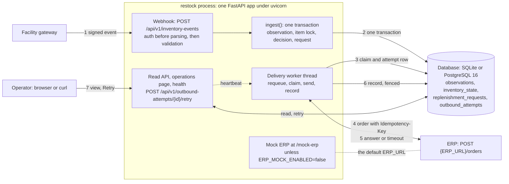

# Design notes

Written before the code, after reading the brief and the fixtures; revised where the build
changed a decision. Three parts: the architecture, the API design (what each endpoint does,
does not do, and how it fails), and the schema. The [report](REPORT.md) explains the reasons;
the [README](../README.md) has the commands.

## 1. Architecture

One process, one database, no broker. The database is the only coordinator: unique keys, a
row lock, a partial unique index and short transactions carry idempotency, ordering, the
one-open-request rule and the delivery queue.

Rules the design rests on:

- An event is either stored and decided, or not stored at all: one transaction.
- No database transaction spans an ERP call. The attempt row is written before the call;
  the result is recorded after it, behind a fence.
- The webhook never depends on the ERP: an ERP outage delays orders, it never refuses events.
- Everything the ERP receives is built from stored columns, so a resend is byte-identical.
- The live demo's gateway and ERP simulators talk only to the service, never to each other.

## 2. API design

Every error has the shape `{"error": "<code>", "message": "<text>"}`; a 422 adds `errors`,
one entry per problem, all listed at once. Nothing is stored on any error.

### POST /api/v1/inventory-events (the webhook)

- **Does:** authenticate (HMAC over `<timestamp>.<raw body>`, replay window 300 s), validate
  every field, store the observation, update the current state if the event is newer, decide
  whether to order, create at most one request. Answers 201 `accepted` with the decision, or
  200 `duplicate` repeating what the first delivery decided.
- **Does not:** call the ERP (the worker does), trust arrival order (`observed_at` orders
  events), replace state with an older event, create a second open request for an item,
  normalise ids (case and whitespace are kept as sent).
- **Failures:** 401 `missing_signature` / `invalid_timestamp` / `invalid_signature` /
  `stale_timestamp`, checked in that order and before the body is parsed; 413 `body_too_large`
  before the body is buffered; 422 `validation_failed` listing every bad field (fixture 07
  gets five), including a payload that is not a JSON object, repeats a key, or holds values
  PostgreSQL cannot store. A redelivery with a different payload is still a duplicate; the
  stored event wins and a warning is logged.

### GET /api/v1/rooms/{room_id}/inventory[?facility_id=]

- **Does:** every item in the room: quantity, thresholds, status, armed flag, last
  observation, open request if any.
- **Does not:** page (a room has few items), include delivered or failed requests.
- **Failures:** 422 for an id with NUL. An unknown room is an empty list, not a 404.

### GET /api/v1/items/{sku}/history?room_id=[&facility_id=&limit=&cursor=]

- **Does:** observations newest first by `(observed_at, event_id)`, stale ones included;
  cursor pagination so a page never skips or repeats a row when new events arrive.
- **Does not:** accept offsets, or return more than 200 rows per page.
- **Failures:** 400 `invalid_cursor` for anything this API did not hand out; 422 for a
  missing `room_id` or a bad `limit`.

### GET /api/v1/outbound-attempts?status=failed|all[&request_id=&limit=]

- **Does:** `failed`: one row per request that is failed now (the attempt that failed it),
  with the request, the HTTP status, the ERP's body and the error text, which is what an
  operator needs to diagnose it. `all`: every attempt, newest first. Each request carries
  `superseded_by` when a newer request for its item has replaced it.
- **Does not:** list lost or in-progress attempts under `failed`; page with a cursor (a
  `limit` of at most 500).
- **Failures:** 422 for a bad filter.

### POST /api/v1/outbound-attempts/{id}/retry

- **Does:** move that attempt's request from `failed` back to `pending`, due now, in one
  conditional UPDATE. Reuses the request's Idempotency-Key, so a retry adds an attempt, never
  a second order. 202 `scheduled` on the click that moved it; 200 `already_scheduled` or
  `already_delivered` on any later click, so repeated clicks are harmless.
- **Does not:** reset the attempt count (each click buys one more attempt), act on a pending
  or in-flight request, or reopen a request whose item has a newer request.
- **Failures:** 404 for an unknown attempt id; 409 `superseded` when a newer request exists
  for the item (retrying would order the bin twice); 422 for a non-integer id.

### GET /health/live, GET /health/ready

- **Does:** `live`: the process answers HTTP; never touches the database. `ready`: the
  database answers, the schema is at the latest migration, the worker is making progress.
- **Does not:** check the ERP. An unreachable ERP must not take the webhook out of service.
- **Failures:** `ready` answers 503 with the failing check named, within 6 s even when the
  database does not answer.

### GET / (the operations page)

- **Does:** show current inventory and the orders that need a person, with a Retry button
  that shows its answer beside it; refreshes every 1.5 s.
- **Does not:** make events or call the ERP; it only reads, and Retry goes through the API.

## 3. Schema

Four tables; an item is `(facility_id, room_id, sku)`.

| Table | One row per | Carries the rule |
| --- | --- | --- |
| `observations` | accepted event, stale ones included | `UNIQUE (event_id)`: the idempotency gate |
| `inventory_state` | item | the newest applied event's values plus `armed` |
| `replenishment_requests` | logical order | partial `UNIQUE (facility_id, room_id, sku) WHERE status IN ('pending', 'in_flight')`: one open order per item; `UNIQUE (idempotency_key)` |
| `outbound_attempts` | ERP call | written before the call, completed after it |

Request status: `pending` → `in_flight` → `delivered` or `failed`; a manual retry moves
`failed` back to `pending`. Attempt classification: `success`, `retryable` (429, 5xx),
`non_retryable` (other 4xx), `ambiguous` (timeout, or a 2xx naming no order), `in_progress`,
`lost` (the claim expired without a result).

Every quantity and threshold has a CHECK constraint, so a buggy write fails instead of
storing a bad row. The schema is created only by the Alembic migration; tests fail if the
models drift from it.
