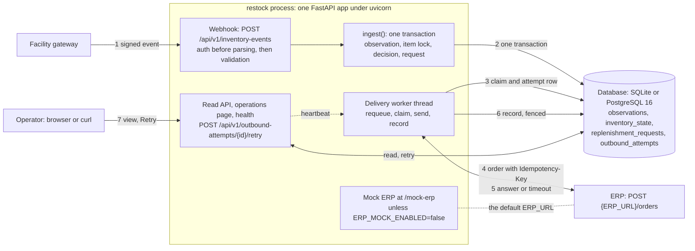
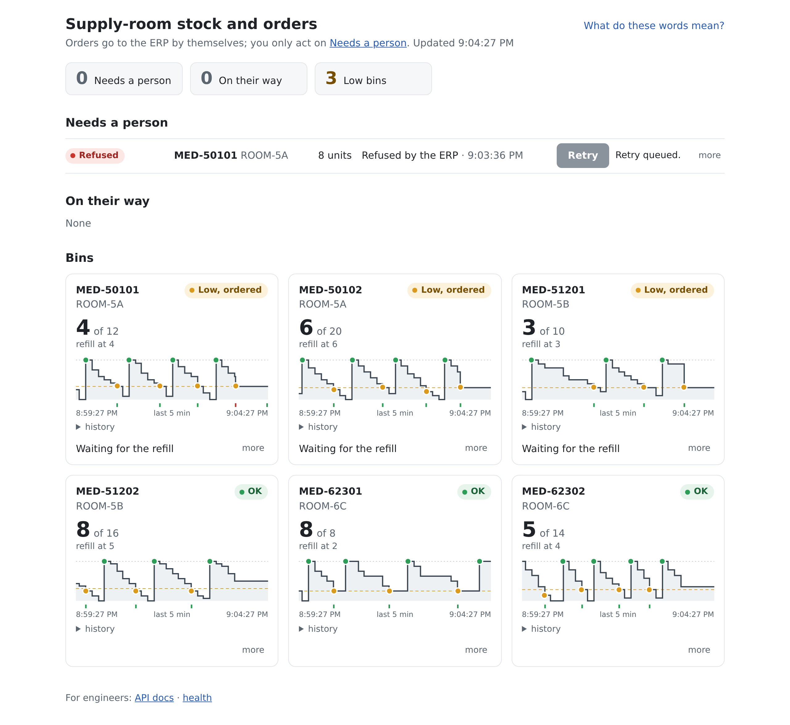

# restock: engineering solution report

**Candidate name:** Wei Wu
**Actual time spent:** 7 hours

Commands are in the [README](../README.md); the design notes written before the code are
[DESIGN.md](DESIGN.md), which also holds the API design. Appendices: A fixture results,
B smaller decisions, C data trace, D test map and mutation checks, E API calls and logs.

## Solution summary

restock is one FastAPI process: a signed webhook, a read API, a server-rendered operations
page, health probes, a delivery worker thread and a mock ERP driven by
`fixtures/outbound/erp_scenarios.json`. It runs on SQLite, or on PostgreSQL 16 in Docker
Compose; only the Alembic migration creates the schema.

**What works.** Every acceptance case gives the brief's result on SQLite, PostgreSQL and
Compose (Appendix A). No ERP scenario yields more than one order per request; manual retry is
safe; an order counts as delivered only when the ERP's answer names it; a process killed
mid-call recovers under the same key.

**What is incomplete.** No authentication on the page, the read API or the retry endpoint; the
mock ERP mounted by default; one worker thread; no metrics (Next steps).

**Main design choice.** The database is the only coordinator; there is no broker. Unique keys,
a row lock, a partial unique index and short transactions carry idempotency, ordering, the
one-open-request rule and the delivery queue.

## Approach

The brief is two unreliable integrations around one invariant: one open request per item, and
one ERP order per request. I ranked risks by cost: a duplicate ERP order first, since nothing
downstream undoes it; then a stale event overwriting state; then an order never sent or
failing unseen; then slow diagnosis. So the invariants live in constraints and locks, the
rules are one pure function tested as a table (`decide()` in `restock/inbound.py`), and every
attempt is recorded before the call. Where the brief leaves room I took the narrowest reading
that keeps the invariant. Once the path worked on both databases I hardened it against what
the fixtures do not show (a crash mid-call, slow answers, two workers, hostile input, a lost
database), each with a test and, for the key invariants, a mutation check.

The 7 hours: understanding the brief, fixtures and data (1 h); architecture, drafted with
Claude and revised by me (30 min); API design in plain text (1 h); schema (30 min), these
three being DESIGN.md; code (2 h), directing Claude to build the prototype and the two demo
simulators while I reviewed; testing and hardening (1 h); this report (1 h). Authentication
and a second worker are next steps rather than built.

## Architecture & data



**Schema** (`alembic/versions/0001_initial_schema.py`; an item is facility + room + SKU):

| Table | One row per | Carries the rule |
| --- | --- | --- |
| `observations` | accepted event, stale ones included | `UNIQUE (event_id)`: the idempotency gate; indexed for history |
| `inventory_state` | item | the newest applied event's values, plus the `armed` flag |
| `replenishment_requests` | logical order | partial `UNIQUE (facility_id, room_id, sku) WHERE status IN ('pending', 'in_flight')`: one open order per item |
| `outbound_attempts` | ERP call | written before the call, completed after it |

Quantities, thresholds and statuses have CHECK constraints; event-id columns use
`COLLATE "C"` on PostgreSQL so the tie-breaker sorts the same on both databases; a test fails
if the models drift from the migration.

**Transactions.** No transaction spans an ERP call. *Event:* insert the observation
`ON CONFLICT DO NOTHING ... RETURNING` (no row back is a duplicate, answered from the stored
row), create and lock the item's state row (`FOR UPDATE` on PostgreSQL, `BEGIN IMMEDIATE` on
SQLite), decide, insert any request in a savepoint, apply, store the decision. *Claim:* one
conditional UPDATE (`pending` and due → `in_flight`, `attempt_count + 1`) plus the attempt
row as `in_progress`. *Record:* complete the attempt row and update the request behind the
fence. *Requeue,* each 0.5 s poll: claims older than the lease back to `pending`, their rows
to `lost`. *Manual retry:* one conditional UPDATE `failed` → `pending`, only while no newer
request exists for the item. PostgreSQL runs at READ COMMITTED.

**Idempotency.** Inbound, `event_id` is unique and inserted first; a concurrent redelivery
waits for the first transaction, then gets 200 `duplicate` with the stored decision.
Outbound, `Idempotency-Key: replenishment:<request_id>` is stored with the request, and the
order body is built from stored columns only, so every attempt sends the same body under the
same key.

## Integration behavior

**Authentication.** `X-Webhook-Signature: v1=<hex>` must equal HMAC-SHA256 over
`<X-Webhook-Timestamp>.<raw body>`, compared in constant time before the body is parsed; the
age check (300 s) comes after the signature, so a forged request is told `invalid_signature`
and only a genuine late one `stale_timestamp`. The app refuses to start without
`WEBHOOK_SECRET`.

**Validation.** The brief's nine fields are required and strictly typed; unknown fields are
kept in `metadata`. `observed_at` may be at most 300 s ahead of server time, or one gateway
with a wrong clock would freeze its bins. A 422 lists every problem (fixture 07 gets five)
and stores nothing.

**Ordering and eligibility.** The key is `(observed_at, event_id)`; only a greater key
replaces the state, and an older event is stored as `stale`. A request for
`max(par_level - observed_quantity, 0)` units, from the event's own thresholds, needs the
event applied and low, no open request for the item, and the item armed: a request disarms
it, and an applied event above the reorder point re-arms it (`recovered`), so a new cycle
needs a recovery, then a later low (05, then 06). The check runs under the item lock; the
partial unique index backs it up.

**Retries and failure classification.** A 2xx whose body names the order (`erp_order_id`,
including 200 `duplicate: true`) is `success`. 429 and 5xx are `retryable`; a timeout, a
connection error or a 2xx naming no order is `ambiguous`; both are retried under the same key.
Any other 4xx is `non_retryable` and fails the request at once. Backoff after attempt *n* is
`min(30 s, 2^(n-1) s)` with jitter; a longer `Retry-After` wins, capped at 300 s; after 6
attempts the request is `failed`, `exhausted`.

**Ambiguous timeouts and recovery.** A timeout may hide an accepted order, so the retry
reuses key and body; under `timeout_after_accept` it gets 200 `duplicate: true` with the same
order id. The attempt row is written before the call, so a process killed mid-call leaves a
trace: once the claim is older than the lease (`4 × ERP_TIMEOUT_SECONDS + 30 s`) the request
goes back to `pending`, the row is marked `lost`, and the order is resent under the same key
(tested with `kill -9`: attempt 1 `lost`, attempt 2 delivered). A late answer passes a fence:
a success delivers the request whichever claim it answers; any other result counts only while
its claim still holds the request.

**Manual retry.** `POST /api/v1/outbound-attempts/{id}/retry` moves a `failed` request to
`pending` with one conditional UPDATE: 202 on the first click, 200 after; it adds an attempt
under the same key, never another order, and answers 409 `superseded` once a newer request
exists for the item. A failed request does not block its bin; the accepted cost is that an
order the ERP took on a timed-out attempt can be reordered by the next cycle, which an ERP
lookup before giving up would close.

## Evidence



The page right after a Retry click on the one order the ERP refused with 422: "Retry queued."
beside the button, the three counts above, and one card per bin with its last five minutes
of stock; bins that need a person are outlined in red, bins low but ordered wait for the refill.

**Tests** at `61d79e1`, `make test` (SQLite) then `make test-pg` (PostgreSQL 16 in Compose):

```text
======================= 289 passed, 2 skipped in 57.90s ========================
============================= 291 passed in 58.46s =============================
```

Appendix A has every fixture and ERP scenario with the observed result, Appendix C the data
trace of `make seed`, and Appendix E representative API calls and log lines.

## Quality & operations

**Tests.** Appendix D maps the brief's minimum test evidence to tests; the suite also covers
manual retry (ten simultaneous clicks: one 202, nine 200s), exhaustion, lost claims, the
fence, readiness, logs, schema drift and the page. Only `make test-pg` exercises the
PostgreSQL row lock; the concurrency tests run through a live server and assert that requests
overlapped.

**Configuration and secrets.** Settings come from the environment or `.env`; `.env.example`
holds placeholders, Compose has no default for `WEBHOOK_SECRET`, and the repository has no
real credential.

**Local topology.** SQLite: `make install`, `make migrate`, `make run`, `make seed`. Compose:
`postgres:16-alpine` plus the app image (migrates on start, healthy from `/health/ready`).
`make demo-up` adds a gateway simulator and an ERP simulator with random faults.

**Health and logging.** `/health/live` never touches the database. `/health/ready` checks the
database, the schema head and worker progress (503 within 6 s) and ignores the ERP on
purpose. Logs are JSON lines with `correlation_id`, `event_id`, `replenishment_id` and
`attempt_no`; the correlation id reaches the ERP as `X-Correlation-ID`.

**Deployment and migration.** Revision 0001 was edited in place before release; a deployed
system would get one revision per change and migrate once per release. On shutdown the worker
stops claiming and waits one ERP timeout; the image runs the server with `exec`, so `docker
stop`'s SIGTERM reaches it. **Not verified:** workers in separate processes, and a real ERP.

## Next steps

1. Authentication on the page and the API, a same-origin check or token on the retry POST,
   and the mock ERP off by default.
2. Before a second worker: a deadline per ERP call below the lease, due checks and leases on
   database time, per-ERP rate limiting.
3. A retry budget in time, not attempts: today a short ERP outage sends every order to
   "Needs a person" after half a minute.
4. Reconcile ambiguous outcomes by looking orders up at the ERP.
5. `UNIQUE (request_id, attempt_no)`; a cursor for the attempts list; proxy caps; two secrets
   during rotation; data retention.

**Scaling and monitoring.** Web instances scale behind a proxy with `WORKER_ENABLED=false`
while one instance runs the worker. Export requests by status, the age of the oldest open
request, attempts by classification and ERP latency; alert on failed requests, an `in_flight`
request past the lease, and readiness 503. **Immediate next actions:** CI running
`make lint`, `make test`, `make test-pg` and the Compose seed; then step 1.

**Open questions.** How long does the ERP keep idempotency keys? Is "failed stays failed until
a retry or a newer cycle" acceptable to purchasing? Should a redelivery with the same
`event_id` and a different payload be a 409? Should low `confidence` block an order?

## Tools & resources

Python 3.12, SQL, HTML with a little JavaScript, and shell. Pinned in `pyproject.toml`:
FastAPI 0.162.0, uvicorn 0.54.0, SQLAlchemy 2.1.6, Alembic 1.20.1, pydantic 2.14.1, psycopg
3.3.6, httpx 0.28.1, Jinja2 3.1.6, pytest 9.2.0, ruff 0.17.3; SQLite 3.45.3; PostgreSQL 16;
Docker Compose v2. References: the brief, `examples/FIXTURE_GUIDE.md`,
`tools/sign_payload.py`, RFC 3339, RFC 9110, RFC 7493.

**AI assistants and generated areas.** Claude Code, with Claude Fable 5.1 for planning and
Claude Opus 5.5 for coding. It wrote the bulk of the code and the tests, the drafts of this
report, and the live demo: the service, the gateway simulator and the ERP simulator.

**How I verified them.** I ran `make test` and `make test-pg` myself, ran the Docker demo and
watched orders fail and be retried, and sent fixtures by hand with `scripts/send.py`. From the
gateway simulator I sent each kind of event it can produce (normal counts, duplicates, late
counts, broken events, two counts at once) and watched the three pages to check that failed
cases were handled and that an order was placed, once, whenever a bin went low.

## Reflection

**Tradeoffs**, each with the production evidence that would test it: a database queue instead
of a broker (order volume, ERP latency); a failed request staying failed until a retry or a
newer cycle (how often the ERP rejects for good); decisions made once, on arrival (how late
events arrive); the 5xx/4xx split (the real ERP's error mix).

**The decision I would revisit first with production evidence.** The retry policy, and that
it is one policy for every site. Stopping after 6 attempts (about 30 s) treats a short ERP
outage like a refusal; that suited the simulation, and data on how long ERP outages last
would decide whether to retry for hours instead. More broadly, the ERP side has to be
customised per site: different ERP APIs, processing and delivery times and ways of failing,
so the timeouts, the retry budget and the failure classification would become per-site
settings.

---

## Appendix A. Fixture acceptance cases

Observed in the recorded run on SQLite; the same sequence gave the same outcomes on
PostgreSQL and inside the Compose stack, where a second seed answered 200 `duplicate` for all
eight valid fixtures and changed nothing.

| Case | Required | Observed |
| --- | --- | --- |
| 01 | Current state updates; no replenishment | 201, decision `none`; quantity 8, `ok`, armed; no request |
| 02 | One request for 8 units | 201, `request_created`; quantity 4, `low`; one request for 8 units, delivered as ERP-7001 |
| 03 after 02 | No duplicate effect, request, or ERP order | 200 `duplicate` with the stored decision and the same request id; the mock holds one order for that key |
| 04 after 02 | History retains the event; state and requests unchanged | 201, `applied: false`, `stale`; `last_event_id` still `evt_1002`; no request; listed in history |
| 05, then 06 | Recovery recorded; the later depletion may begin a new cycle | 05: `recovered`, quantity 12, armed. After ERP-7001 was delivered, 06: `request_created`, quantity 3, a second request for 9 units, ERP-7002 |
| 07 | Clear rejection, no partial persistence or outbound work | 422 `validation_failed` with five errors (`room_id` missing, bad `observed_at`, quantity -3, reorder point above par, confidence 1.4); no row, no ERP call |
| 08 + 09 concurrently | Both retained; later is current; at most one request for 8 units | Both 201: `evt_2002` `request_created` for 8 units, `evt_2001` `stale`; `evt_2002` current; one request, ERP-7003. When 08 commits first, 09 is `blocked_not_armed`, with the same end state |
| ERP `timeout_after_accept` | Retry uses the same key; one logical order | Attempt 1 `ambiguous` after 5,002 ms; attempt 2 200 `duplicate: true`, same order id; same key and identical bodies; the mock stored one order |

The other scenarios in `fixtures/outbound/erp_scenarios.json`:

| Scenario | Observed |
| --- | --- |
| `success` | the seed's three requests delivered on the first attempt |
| `duplicate_idempotency_key` | a known key gets 200 `duplicate: true` with the stored order id |
| `rate_limited`, `temporary_failure`, `success` | 429, 503, 201 under one key; attempt 2 waited the 2 s `Retry-After`; one order |
| `temporary_failure` six times | six 503s with growing backoff, then `failed`, `exhausted`; Retry gave 202, then 200 `already_scheduled`; manual attempt 7 delivered; a further Retry gave `already_delivered` |
| `permanent_rejection` | 422 `unknown_sku`: `failed` at once, listed by `status=failed` and on the page; Retry from the page gave 202 and attempt 2 delivered |
| `timeout_after_accept`, then `kill -9` | after the restart the expired claim was marked `lost` (34,331 ms) and attempt 2 delivered under the same key |

## Appendix B. Smaller decisions

The API design (what each endpoint does, does not do and how it fails) is in
[DESIGN.md](DESIGN.md), as written before the code. Decisions too small for the body:

- **Optional fields.** `source`, `camera_id` and `metadata` are optional because the brief's
  example has none of them; unknown top-level fields are stored under `metadata["_extra"]`.
- **Cross-field check as a field validator**, so 07 lists all five problems at once (pydantic
  skips model validators once a field fails).
- **Years 1970–9998 in UTC only.** Near year 1 or 9999 the conversion overflowed, and on
  PostgreSQL a year-1 event made every later history read for the item fail.
- **Timestamp header is signed exactly as received**, never stripped; more than 12 digits is
  `invalid_timestamp` (usually milliseconds sent by mistake).
- **Low with nothing needed** (`quantity == par == reorder_point`): decision `none`, no
  request. **A blocked event does not consume the recovery:** `blocked_open_request` leaves
  the item armed.
- **Every ERP answer leaves an attempt row,** even one the database refuses to store (it is
  stored again without the body), so no request is stuck `in_flight` without a trace.
- **The failed list shows one row per failed request** (its latest attempt); `status=all`
  lists every attempt.
- **Mock ERP** numbers orders ERP-7001, ERP-7002, ... and remembers keys in memory only, so a
  restart forgets them; error scenarios answer before the key lookup, like a rate limiter in
  front of an ERP.
- **Correlation ids** from a header or the event are used only if they match
  `[A-Za-z0-9._:-]{1,128}`, since they end up in HTTP headers.
- **Both health probes are async,** so liveness answers even when every worker thread is
  stuck on the database; PostgreSQL connects with a 5 s timeout.

## Appendix C. Data trace of the fixture sequence

`make seed` on a fresh SQLite database (every valid `observed_at` is on 2026-08-18):

| Step | Event | observed_at | Qty | HTTP | Decision | Request |
| --- | --- | --- | --- | --- | --- | --- |
| 01 | evt_1001 | 19:20:00 | 8 | 201 | none | none |
| 02 | evt_1002 | 19:22:10 | 4 | 201 | request_created | 8 units, ERP-7001 |
| 03 | evt_1002 | 19:22:10 | 4 | 200 | duplicate, repeating request_created | the same one |
| 04 | evt_0999 | 19:10:00 | 2 | 201 | stale | none |
| 05 | evt_1003 | 20:00:00 | 12 | 201 | recovered | none |
| 06 | evt_1004 | 21:00:00 | 3 | 201 | request_created | 9 units, ERP-7002 |
| 07 | evt_invalid_01 | invalid | -3 | 422 | not stored | none |
| 08 + 09 | evt_2001, evt_2002 | 20:15:00.000, .001 | 2, 2 | 201, 201 | stale, request_created | 8 units, ERP-7003 |

## Appendix D. Test map and mutation checks

| Minimum test evidence (brief, C) | Tests in `tests/` |
| --- | --- |
| Low-stock path, exact quantity | `test_guide_sequence_01_to_06` (8, then 9 units); `test_the_erp_receives_the_low_stock_order` |
| Duplicates, concurrent qualifying events | `test_twenty_parallel_redeliveries_store_one_row`, `test_concurrent_08_and_09_with_redeliveries`, `test_parallel_distinct_low_events_create_one_request`, `test_parallel_events_for_an_existing_item_are_serialised` |
| Out-of-order events, state protected | `test_guide_sequence_01_to_06` (step 04), `test_ordering_and_tie_break`, `test_late_recovery_does_not_rearm` |
| Retryable failure, timeout after accept, stable key | `test_rate_limited_then_unavailable_then_success`, `test_timeout_after_accept_resolves_to_one_order_with_the_same_key`, `test_order_body_is_identical_on_every_attempt` |
| A validation or authentication failure | `test_invalid_fixture_lists_every_problem_and_persists_nothing`, `test_wrong_secret_is_rejected`, `test_timestamp_outside_the_window_is_rejected` |

Mutation checks I ran by hand, each reverted afterwards:

| Change to the code | Result |
| --- | --- |
| no `FOR UPDATE` on the state row (PostgreSQL) | `test_parallel_events_for_an_existing_item_are_serialised` fails 5 of 5 runs (an older event overwrote the newer state) |
| a new Idempotency-Key per attempt | `test_timeout_after_accept_resolves_to_one_order_with_the_same_key` fails |
| no ordering check | sequence and concurrency tests fail |
| no `ON CONFLICT` on the observation insert | `test_twenty_parallel_redeliveries_store_one_row` fails |
| ignore the armed flag | sequence and 08+09 tests fail |
| no open-request pre-check | only the backstop test fails; the partial unique index still yields `blocked_open_request` |
| decide with stored thresholds instead of the event's | `test_each_event_thresholds_decide_for_that_event` and `test_a_lowered_reorder_point_creates_no_request` fail |
| no claim guard in the worker | `test_a_claim_requires_the_request_to_still_be_pending` fails on both databases |

## Appendix E. API calls and logs

From a recorded run at commit `b87b532`, replayed with the same results at `34cdaa8`. An
unsigned call, then three Retry clicks on one exhausted order (`curl -i`, headers trimmed):

```text
$ curl -sS -X POST :8510/api/v1/inventory-events --data-binary @fixtures/inbound/01_normal_stock.json
{"error":"missing_signature","message":"X-Webhook-Timestamp and X-Webhook-Signature are required"}
$ curl -sS -i -X POST :8510/api/v1/outbound-attempts/16/retry      (three times)
HTTP/1.1 202 Accepted   {"result":"scheduled","attempt_id":16,"request_id":"c6a4728c-...","request_status":"pending"}
HTTP/1.1 200 OK         {"result":"already_scheduled","attempt_id":16,"request_id":"c6a4728c-...","request_status":"pending"}
HTTP/1.1 200 OK         {"result":"already_delivered","attempt_id":16,"request_id":"c6a4728c-...","request_status":"delivered"}
```

The timeout scenario's two attempts under one correlation id, as logged:

```text
{"ts": "2026-10-28T06:28:32.481Z", "level": "INFO", "logger": "restock.outbound", "msg": "erp attempt finished", "correlation_id": "corr_demo_timeout", "event_id": "evt_9102", "replenishment_id": "6adecb59-d458-47ad-ae4e-fc5439245c51", "attempt_no": 1, "classification": "ambiguous", "duration_ms": 5002, "request_status": "pending", "next_attempt_in_s": 0.763, "triggered_by": "worker"}
{"ts": "2026-10-28T06:28:33.507Z", "level": "INFO", "logger": "restock.outbound", "msg": "erp attempt finished", "correlation_id": "corr_demo_timeout", "event_id": "evt_9102", "replenishment_id": "6adecb59-d458-47ad-ae4e-fc5439245c51", "attempt_no": 2, "classification": "success", "http_status": 200, "duration_ms": 2, "request_status": "delivered", "triggered_by": "worker"}
```
